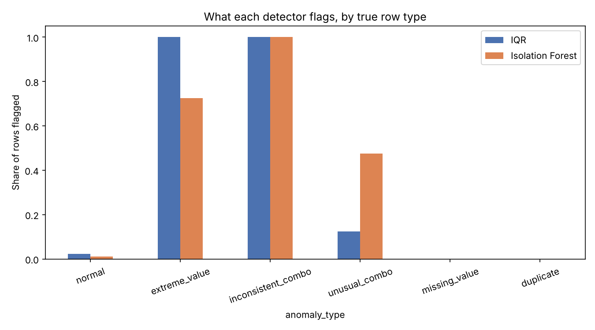
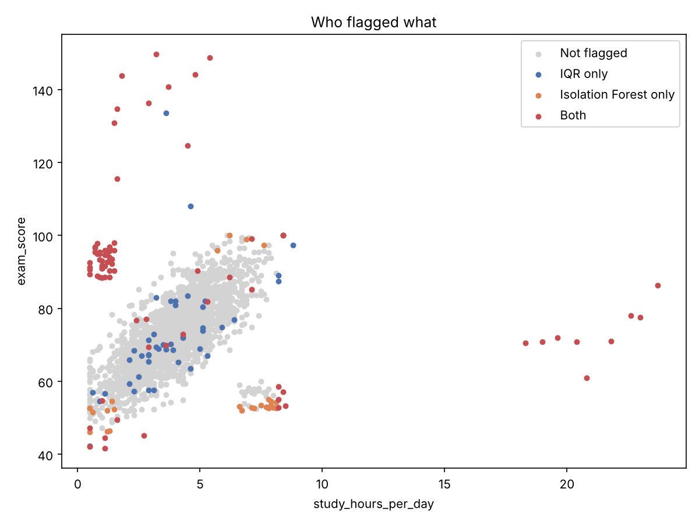

# Data Probe

  [](../../actions/workflows/tests.yml)

Data Probe checks student-data CSVs for missing values, duplicates, known
range violations, and unusual numeric records. It compares an IQR rule with
Isolation Forest and treats detector flags as records to review, not confirmed
errors.

## Results at a glance




## Features

- Analyze the included synthetic dataset, the UCI Student Performance
  mathematics dataset, or an uploaded CSV.
- Compare detector flags and, for the synthetic dataset only, report precision,
  recall, F1, and results by anomaly type.
- Inspect suspicious records, data-health summaries, and an interactive
  three-axis map in the local web app.
- Export flagged rows as CSV and aggregate results as PDF.
- Optionally explain aggregate results with a locally running Ollama model.

Only numeric, non-constant columns are passed to the detectors. Synthetic
ground-truth columns are excluded from model inputs. Uploaded or UCI labels are
not treated as verified truth.

## Project layout

| Path | Purpose |
|---|---|
| `main.py` | Command-line analysis |
| `web_app.py` | Flask app and JSON/PDF endpoints |
| `data_generator.py` | Labeled synthetic student data |
| `data_cleaning.py` | CSV loading and data-health checks |
| `statistical_detector.py` | IQR detector |
| `ml_detector.py` | Isolation Forest detector |
| `evaluation.py` | Metrics for the synthetic data |
| `report_generator.py` | Suspicious-record table and PDF report |
| `robustness.py` | Repeat synthetic evaluation across random seeds |
| `visualize.py` | Static charts generated by the CLI |
| `templates/`, `static/` | Web UI |
| `datasets/` | Synthetic output and UCI source CSV |
| `outputs/` | CLI reports and charts |

## Install and run

From the project directory:

```bash
# macOS / Linux
python3 -m venv .venv
source .venv/bin/activate
pip install -r requirements.txt
```

```powershell
# Windows (PowerShell)
py -m venv .venv
.\.venv\Scripts\Activate.ps1
pip install -r requirements.txt
```

Run the command-line analysis:

```powershell
python main.py
python main.py --csv datasets/student-mat.csv
python main.py --csv your.csv --k 2.0
python main.py --csv datasets/student-mat.csv --x-feature age --y-feature G3
```

`--csv` defaults to `datasets/generated_data.csv`, which is generated when
missing. `--k` sets the IQR fence multiplier (default `1.5`);
`--contamination` sets the Isolation Forest value (default `0.05`, accepted
range `(0, 0.5]`). `--x-feature` and `--y-feature` select scatter-plot axes;
both must be distinct numeric feature columns. CLI reports and charts are
written to `outputs/`.

Run the tests and multi-seed evaluation with:

```powershell
python test_core.py
python test_web_app.py
python robustness.py
```

Start the dashboard with `python web_app.py`, then open
`http://127.0.0.1:5000`. The app analyzes data locally. Uploads are limited to
10 MB and 20,000 rows. CSV delimiter detection supports comma- and
semicolon-separated files.

## Web API

- `GET /` serves the dashboard; `GET /profile-qr.svg` generates its profile QR
  code.
- `POST /api/analyze` accepts form fields `source` (`synthetic`, `uci`, or
  `upload`), `k`, and `contamination`. For `source=upload`, include the CSV in
  the `file` field. The response contains data-health totals, detector counts,
  chart rows, and a capped suspect preview; CSV export data includes all
  flagged rows.
- `POST /api/report.pdf` accepts an aggregate analysis summary and returns a
  PDF. Raw records are not accepted.
- `GET /api/llm-status` checks the local Ollama model.
- `POST /api/explain` accepts aggregate counts and, for labeled practice data,
  validated detector metrics. It does not accept row-level data.

## Local AI explanation

The optional explanation uses Ollama on `127.0.0.1`; it sends only aggregate
counts and, for the synthetic dataset, evaluation metrics. It does not send
student rows, feature values, or uploaded filenames. Install and start Ollama,
then download the default model:

```powershell
ollama pull llama3.2
```

To select another installed model, set `DATAPROBE_OLLAMA_MODEL` before starting
Flask. The dashboard, analysis, and PDF export work without Ollama.

## Data and evaluation

The generated dataset contains 2,000 normal rows and 40 rows each for extreme
values, inconsistent combinations, unusual combinations, missing values, and
duplicates. The detector evaluation target includes the first three anomaly
types (120 rows); missing values and duplicates are handled by data-health
checks. Scores are in-sample results on designed data, not a held-out test.

The included UCI mathematics dataset has 395 rows and 33 columns and uses
semicolons. It has no trusted anomaly labels, so the app does not report
accuracy for it or for uploaded data. Known-range checks cover selected student
age, grade, and survey-scale columns; review those limits for your own data.

With the default synthetic seed, `k=1.5`, and contamination `0.05`, the
detectors flag 129 rows with IQR and 110 with Isolation Forest; 84 are flagged
by both. Against the 120 planted value anomalies:

| Detector | Precision | Recall | F1 |
|---|---:|---:|---:|
| IQR | 0.659 | 0.708 | 0.683 |
| Isolation Forest | 0.800 | 0.733 | 0.765 |
| Either (OR) | 0.639 | 0.825 | 0.720 |
| Both (AND) | 0.881 | 0.617 | 0.725 |

On the included UCI file, IQR flags 163 rows and Isolation Forest flags 20;
19 are flagged by both. Those counts are not accuracy measures.

On the synthetic data, recall by row type is:

| Row type | IQR | Isolation Forest |
|---|---:|---:|
| Extreme value | 1.000 | 0.725 |
| Inconsistent combination | 1.000 | 1.000 |
| Unusual combination | 0.125 | 0.475 |
| Missing value or duplicate | 0.000 | 0.000 |

Across 10 generated datasets, mean F1 was 0.733 for IQR and 0.720 for
Isolation Forest. Mean recall on unusual combinations was 0.120 and 0.405,
respectively. These results vary by random seed.

The Isolation Forest contamination setting changes its precision/recall
trade-off: at `0.02` the measured values were `0.955` / `0.350`; at `0.10`
they were `0.523` / `0.958`. Raising IQR `k` from `1.5` to `2.0` reduced its
flags from 129 to 77 and changed precision/recall from `0.659` / `0.708` to
`0.974` / `0.625`.

## Dataset credit

`datasets/student-mat.csv` is the Student Performance (mathematics) dataset
from the UCI Machine Learning Repository, by P. Cortez and A. Silva (2008),
used under CC BY 4.0. The synthetic dataset is generated by
`data_generator.py`.

## License

MIT. See [LICENSE](LICENSE).
